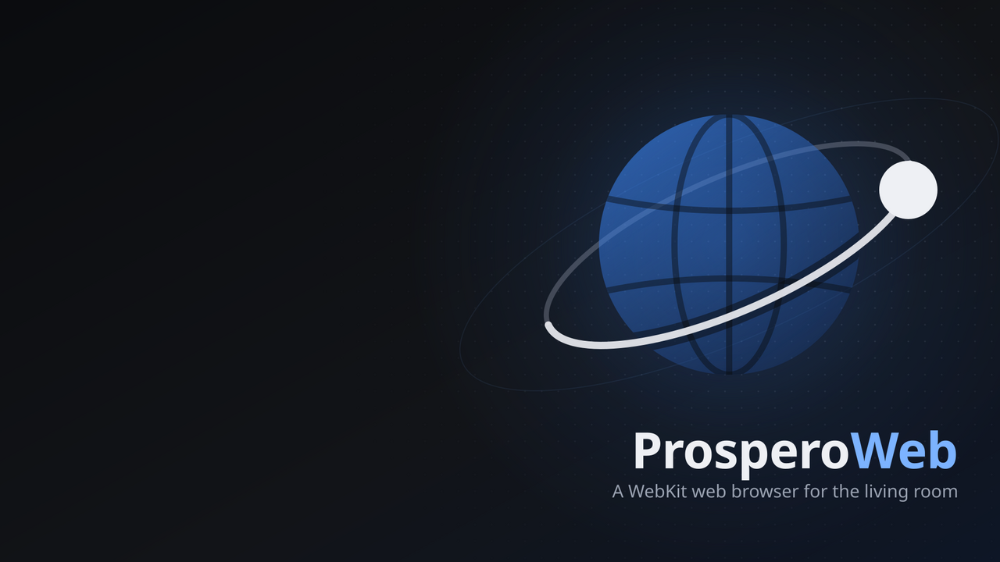

# ProsperoWeb

[](https://github.com/kvaps/ProsperoWeb/actions/workflows/ci.yml)

A WebKit-based web browser for jailbroken PlayStation 5 consoles. It builds upstream WebKit's PlayStation port with the open [ps5-payload-sdk](https://github.com/ps5-payload-dev/sdk), adds an ffmpeg media engine (including Media Source Extensions) and an elfldr-derived process spawner, and runs a 10-foot browser shell (tabs, address bar, gamepad and touchpad pointer, system keyboard) that is shared with a WebKitGTK host frontend for development.

Repository: https://github.com/kvaps/ProsperoWeb (earlier names: ps5-browser, ProsperoBrowser).

ProsperoWeb is an independent homebrew project and is not affiliated with or endorsed by Sony Interactive Entertainment.



## Status

ProsperoWeb runs on real hardware as a native home-screen title. It has been tested on the developer's console, whose spawn log reports `fw 0x13420000`; other firmware versions are untested. On that console it loads and renders sites such as Google and rezka, keeps a signed-in session, plays YouTube (Media Source Extensions, H.264) and rezka (HLS) with picture and sound, seeks within a video, and decodes 8-bit H.264 and HEVC in hardware through the console's `sceVideodec2`. What was checked and how to report problems are in [docs/console-verification.md](docs/console-verification.md).

It is early software (version 0.1.0): expect rough edges, and launch it only the way described below.

## Features

- Tabs, address bar with URL/search normalisation, back/forward/reload, bookmarks and history, session restore.
- DualSense: a virtual pointer on the left stick or the touchpad (trackpad-style: slide, tap, two-finger scroll, press and slide to drag), trusted clicks and scrolling, tab switching, menu; USB keyboard.
- Text entry through the console's own keyboard dialog, pre-filled with the URL or the field's value; a built-in on-screen keyboard (Latin, Cyrillic, symbols) as the fallback.
- HTML5 Fullscreen API and a chrome-hiding fullscreen mode.
- HTML5 `<video>`/`<audio>` through an ffmpeg engine: Media Source Extensions (YouTube-style players; H.264 up to 1080p by default), progressive MP4/WebM and native HLS; software decoding (H.264, HEVC, VP8, VP9; AAC, MP3, Opus and others). Video is composed by the UI process under the page, audio is mixed and played by the UI process. Hardware decoding of 8-bit H.264 and HEVC with the console's `sceVideodec2` in the UI process, verified on the developer's console, with automatic fallback to software (`PROSPEROWEB_VIDEO_DECODE=webprocess` turns it off).
- Add-ons (menu → Ad blocker / SponsorBlock): a built-in **ad blocker** (on by default) built from EasyList, EasyPrivacy, uBlock Origin's lists and Peter Lowe's list, enforced by WebKit's native content rule list (network blocking + element-hiding CSS, incl. YouTube promoted/masthead/sidebar), plus a small fail-open user script that removes YouTube pre/mid-roll video ads via JSON pruning. Optional cookie-banner filter, and background list updates on the console. Plus a bundled **SponsorBlock** user script (off by default) skipping YouTube segments by category. Not uBlock Origin and not the SponsorBlock extension — independent implementations using the public lists/API.
- Bundled fonts with Latin, Cyrillic, CJK and colour emoji coverage (Noto, Noto CJK, Noto Color Emoji, Liberation, DejaVu).
- JavaScript JIT (baseline + DFG; FTL off) and WebAssembly, ~1.7x faster than the interpreter on a micro-benchmark; `config.json` `"env"` can turn them off ([docs/ps5-runtime.md](docs/ps5-runtime.md#javascript-jit-and-webassembly)).
- English and Russian UI.
- DRM notice: known DRM-only sites and pages that request EME get a clear message instead of a broken player.
- Add-ons: a built-in ad blocker (native WebKit content rule list from EasyList, EasyPrivacy, Peter Lowe and uBlock Origin lists, plus a YouTube page/pre-roll script) and SponsorBlock (skips YouTube sponsor segments), toggled from the menu. These are independent implementations using the public lists and API, not the uBlock Origin or SponsorBlock extensions.

## Known limitations

- **A privileged ELF loader is required.** The sandboxed title cannot create its own processes (verified on the console: `rfork_thread` is refused with `EPERM`), so a loader must start the web and network processes. A loader on `127.0.0.1:9021` does this; etaHEN, many jailbreak hosts, or a standalone elfldr all provide one, and the UI connects to the spawn broker as soon as it is up. The websrv tile is the fallback.
- **Hardware video decoding covers 8-bit H.264 and HEVC** (`sceVideodec2`). VP8, VP9 and AV1 always decode in software, and high resolutions or frame rates in software can drop frames, so players are steered to H.264 at up to 1080p by default.
- **No DRM sites** (Netflix, Disney+, Kinopoisk, Okko, ...): there is no CDM, by design.
- **No GPU acceleration**: software rendering only; no WebGL, no CSS 3D, no GPU compositing.
- **No WebAudio.**
- **Ad blocker is network-first and best-effort on YouTube video ads.** A console sandbox limit on shared-memory handles means one merged rule list is attached; on-device list updates fetch from EasyList's host, while the full uBlock/Peter Lowe/cookie coverage ships bundled.
- **The ad blocker uses WebKit's content rule list, not uBlock Origin.** It blocks network requests and hides elements (css-display-none) from EasyList/EasyPrivacy/uBlock/Peter-Lowe, but has no scriptlets and no procedural/extended-CSS cosmetic filters (those rules are dropped and counted). The merged set is capped at WebKit's 150000-rule limit, network rules prioritised. YouTube client-scheduled pre/mid-roll is removed by a small JSON-prune user script; server-stitched ads are best-effort. On-device list refresh needs network and recompiles the rule list (CPU/memory), falling back to the cached/bundled baseline offline.
- **Only firmware 13.42 is tested**; other versions are untested.

See also [docs/architecture.md](docs/architecture.md#non-goals).

## Install

### Native title

`PRWB00001` is the browser UI itself as a native title: one folder, launched from the home screen like any other app, with the profile created automatically in `/data/prosperoweb/`. Its `eboot.bin` is the UI linked as a native application; its `prosperoweb.elf` is the payload that the spawn helper runs for the WebProcess and NetworkProcess. Prerequisites: a jailbroken PS5 with a kernel jailbreak (etaHEN or kstuff/kstuff-lite), [ShadowMountPlus](https://github.com/drakmor/ShadowMountPlus) (lists the title on the home screen) and an ELF loader on `127.0.0.1:9021` (provided by etaHEN, many jailbreak hosts, or a standalone elfldr; starts the spawn helper, websrv on port 8080 is the fallback). A separate elfldr is not needed when the jailbreak already provides one.

1. Get `PRWB00001.zip` from a CI run or release, or build it (`cmake --build build-ps5 --target prosperoweb prosperoweb_native`, `scripts/ps5/package.sh`, `scripts/ps5/native/make-title.sh`).
2. Unpack it so that the console has `/data/homebrew/PRWB00001/eboot.bin` (ShadowMountPlus scans `/data/homebrew` by default). Copy the zip and unpack it on the console, or keep the execute bit of `eboot.bin` when copying loose files.
3. Wait for ShadowMountPlus's next scan (15 s by default), then start "ProsperoWeb" from the home screen.

The first launch writes `/data/prosperoweb/log.txt` from the first line on. If the title does not start, the websrv tile below still works; [docs/native-title.md](docs/native-title.md) lists what to look for and how to fall back. The title is in the ProsperoStore catalog ([docs/store-submission.md](docs/store-submission.md)).

### Current install: websrv tile

What works today. You need a jailbroken PS5 running [ps5-payload-dev/websrv](https://github.com/ps5-payload-dev/websrv) (port 8080, launches the browser) and an FTP server such as ps5-payload-dev/ftpsrv (port 2121); klogsrv (port 3232) is useful for debug output. About 240 MB of free space in `/data`, plus the cache.

1. Get `ProsperoWeb-<version>-data.zip` from a [release](https://github.com/kvaps/ProsperoWeb/releases) (or a CI run's artifacts), or build `dist/` yourself (below). It holds two folders, `prosperoweb/` and `homebrew/prosperoweb/`.
2. Copy them over FTP: `prosperoweb/` to `/data/prosperoweb/` and `homebrew/prosperoweb/` to `/data/homebrew/prosperoweb/` (the websrv tile), for example `lftp -p 2121 PS5_IP -e "mirror -R prosperoweb /data/prosperoweb; mirror -R homebrew/prosperoweb /data/homebrew/prosperoweb; quit"`. The browser must live in `/data/prosperoweb/`; its profile (tabs, history, bookmarks, web data) is created there on the first start.
3. Open `http://PS5_IP:8080/` (or the Homebrew Launcher) and select the "ProsperoWeb" tile.

**Launch only through the websrv tile.** Started through elfldr or the Payload Manager, the browser runs as a background payload: no picture, and its processes keep running until the console runs out of memory. Reboot the console after a launch that showed no picture. Quit with Options → Quit to save the session.

`prosperoweb/README-install.txt` has the full steps; `config.json.sample` lists the settings (home page, language, user agent).

Upgrading from ProsperoBrowser (`/data/prosperobrowser/`) or ps5browser (`/data/ps5browser/`): install as above, remove the old tile (`/data/homebrew/prosperobrowser/` or `/data/homebrew/ps5browser/`) and leave the old data directory in place for the first start. The browser copies the profile once from the newest old directory that has one, and still accepts the old `PROSPEROBROWSER_*` and `PS5BROWSER_*` variables for this release ([details](docs/ps5-runtime.md#upgrading-from-prosperobrowser-or-ps5browser)).

## Build from scratch (PS5)

Build host: Linux x86-64 (Ubuntu 24.04 used), 4+ cores, 15 GB RAM, at least 10 GB free disk (SDK 0.7 GB, WebKit checkout 1.3 GB, WebKit build tree 3.2 GB, dependencies 0.7 GB, plus the frontend build and `dist/`). The WebKit build takes several hours on 4 cores.

Host packages:

```sh
sudo apt-get install --assume-yes --no-install-recommends \
  clang-18 lld-18 llvm-18 cmake ninja-build ruby perl python3 gperf unifdef \
  pkg-config autoconf automake libtool bison flex wget unzip python3-pyelftools \
  python3-venv curl zip file zlib1g-dev g++ imagemagick librsvg2-bin
```

The ps5-payload-sdk with the prebuilt pacbrew libraries (SDL2, curl, OpenSSL, FFmpeg, ...), bundle v0.41.1, into `/opt/ps5-payload-sdk`:

```sh
mkdir -p /tmp/ps5sdk && cd /tmp/ps5sdk
wget https://github.com/ps5-payload-dev/pacbrew-repo/releases/download/v0.41.1/ps5-payload-dev.tar.gz
echo "e811bc2e4676c5bb7f80a8fe928d2985dce599996a5ca6b54da3e72699287887  ps5-payload-dev.tar.gz" | sha256sum --check
tar --no-same-owner -xzf ps5-payload-dev.tar.gz
sudo cp -a opt/ps5-payload-sdk /opt/ && sudo chown -R root:root /opt/ps5-payload-sdk
export PS5_PAYLOAD_SDK=/opt/ps5-payload-sdk
```

Then, from the repository root:

```sh
scripts/ps5/build-deps.sh          # third_party/ps5-prefix: ICU, HarfBuzz, FreeType, libwpe, ...
scripts/ps5/fetch-webkit.sh        # third_party/webkit at the pinned commit + webkit-port/patches
scripts/ps5/build-webkit.sh all    # build-wk-ps5/: libWebKitPS5.a + ps5webkit-link.cmake
cmake -S . -B build-ps5 -DCMAKE_TOOLCHAIN_FILE=/opt/ps5-payload-sdk/toolchain/prospero.cmake \
      -DPROSPEROWEB_FRONTEND=ps5 -DPROSPEROWEB_BUILD_TESTS=OFF -DCMAKE_BUILD_TYPE=Release
cmake --build build-ps5 -j4 --target prosperoweb
scripts/ps5/package.sh             # dist/prosperoweb/ + dist/homebrew/prosperoweb/
scripts/ps5/native/make-title.sh   # optional: build-dist/native/PRWB00001/ + build-dist/PRWB00001.zip
```

All scripts are idempotent and resumable; their headers list the environment variables (`JOBS`, `PS5_DEPS_PREFIX`, `WEBKIT_BUILD_DIR`, `USE_FFMPEG`, ...). `package.sh` needs `curl` and ImageMagick (`convert`); `make-title.sh` builds its host tools with `clang++` and `g++` (OpenMP) and `zlib`; `scripts/assets/render.sh` re-renders the home screen artwork from `assets/*.svg` (needs `rsvg-convert`). Details: [webkit-port/README.md](webkit-port/README.md).

## Host build, tests and screenshots

The host frontend runs the same shell and chrome on a desktop. It needs CMake 3.20+, a C++20 compiler, GTK 4, WebKitGTK 6.0 and, optionally, SDL2 for a game controller (on Ubuntu 24.04: `libgtk-4-dev libwebkitgtk-6.0-dev libsdl2-dev`, plus `gstreamer1.0-plugins-good gstreamer1.0-plugins-bad gstreamer1.0-libav` for video).

```sh
cmake -S . -B build-gtk -DPROSPEROWEB_FRONTEND=host-gtk
cmake --build build-gtk -j4
ctest --test-dir build-gtk            # core, shell, spawn helper and media unit tests
build-gtk/src/frontend/host-gtk/prosperoweb-host --url https://en.wikipedia.org/wiki/PlayStation_5
```

Options: `--size WxH` (default 1920x1080), `--profile DIR` (default `$XDG_DATA_HOME/prosperoweb`; session, history and bookmarks live in `DIR/state`), `--url URL`, `--screenshot PATH --after-ms N` (save a PNG and exit), `--demo[=KIND]` (chrome demo state over `about:blank`), `--lang en|ru`, `--user-agent UA`, `--chrome-dir DIR`, `--input LIST` (press gamepad buttons after start, for automation). `--help` lists them all.

The chrome is loaded from `--chrome-dir`, `$PROSPEROWEB_CHROME_DIR`, the install location (`share/prosperoweb/chrome-ui`) or the source tree, whichever has `chrome.html` first. `cmake --install` installs the binary and the chrome.

Headless, for example in CI or a container (`WEBKIT_DISABLE_SANDBOX_THIS_IS_DANGEROUS=1` only where bubblewrap cannot create namespaces):

```sh
WEBKIT_DISABLE_SANDBOX_THIS_IS_DANGEROUS=1 xvfb-run -a -s "-screen 0 1920x1080x24" \
  build-gtk/src/frontend/host-gtk/prosperoweb-host --demo --screenshot /tmp/chrome.png --after-ms 3000
```

See [docs/screenshots/](docs/screenshots/README.md) for screenshots and the commands that produced them.

### Host input mapping

The keyboard stands in for a DualSense; an SDL2 game controller, if connected, works at the same time. The PS5 uses the same button mapping.

| Key | Button | Action in page mode |
| --- | --- | --- |
| Arrows | D-pad | Scroll |
| Enter | Cross | Click at the pointer |
| Escape | Circle | Back / leave fullscreen |
| F1 | Triangle | Edit the address (system keyboard on the PS5, OSK on the host) |
| F2 | Square | Edit the focused text field (system keyboard on the PS5, OSK on the host) |
| `[` / `]` | L1 / R1 | Previous / next tab |
| Page Up / Page Down | L2 / R2 | Page up / down |
| F10 | L3 | Hide / show the chrome |
| F11 | R3 | Fullscreen (hide the chrome; leaves page fullscreen) |
| F9 | Options | Menu |
| F8 | Share (Create) | Reload |
| F7 | Touchpad button | Click at the pointer, held while pressed (press and slide drags) |
| W A S D (held) | Left stick | Move the pointer |
| I J K L (held) | Right stick | Scroll |
| (none) | Touchpad surface | One finger moves the pointer (relative, accelerated), a quick tap clicks, two fingers scroll (the content follows the fingers) |

New tab: Options menu → New tab, or `+` in the tab strip (the touchpad button opened one before it became the mouse button; in chrome focus it still does).

The touchpad works on the host only with a DualSense connected through SDL2; there is no keyboard or mouse emulation of it (the real mouse already goes to the page).

On the PS5, Triangle, Square and a click into a text field open the console's own keyboard dialog, pre-filled with the URL or the field's value; confirming navigates or replaces the field's value, cancelling changes nothing. The built-in OSK below is the fallback when the dialog fails, and the only keyboard with `PROSPEROWEB_OSK=builtin` (or `"osk": "builtin"` in `config.json`) and on the host; see docs/ps5-runtime.md, "Text input".

In the OSK: D-pad moves between keys, Cross types the key at the caret, L1/R1 move the caret, Square deletes before the caret, Triangle inserts a space, L2 is Shift, Touchpad (or the on-screen layout key) switches the layout, Options commits, Circle cancels. Holding the D-pad, Square, L1 or R1 repeats; the on-screen Clear key empties the text. In the menu: D-pad up/down selects, Cross activates, Circle goes back.

While a text field in the page or the HTML address bar has focus, only the function keys stay mapped, so typing reaches the field. The real mouse goes straight to the page; moving it hides the gamepad pointer until a stick or the touchpad moves it again.

Host limitations:

- WebKitGTK has no public API to inject input events, so gamepad clicks, stick scrolling and `EngineView::key()` are JavaScript fallbacks on the host (`elementFromPoint().click()`, `scrollBy()`, dispatched `KeyboardEvent`s). They are untrusted: no user activation, so for example a page cannot enter fullscreen from a gamepad click. The PS5 frontend delivers real engine events.
- The chrome is a full-window transparent web view over the page. GTK 4 has no per-pixel input shape for a child widget, so the chrome only receives the mouse while it has focus (OSK, menu, notice, address typing) or while the mouse is over the top band.
- Native HLS (`<video src=*.m3u8>`) is behind `WEBKIT_GST_ENABLE_HLS_SUPPORT=1` in WebKitGTK; the host sets it unless it is already set.
- The Ubuntu WebKitGTK build has no EME (`navigator.requestMediaKeySystemAccess` is undefined), so the EME detector never fires on the host. Known DRM-only sites still get the notice before navigation.

## CI and releases

GitHub Actions ([.github/workflows/](.github/workflows/)) runs on every push and pull request:

- `host`: the core, shell, spawn helper, media and chrome UI unit tests (`ctest`, with node for the chrome test), and a compile of the GTK host frontend.
- `ps5`: the full PS5 build from scratch as described above (SDK, dependencies, WebKit, frontend, `package.sh`, native title). The SDK tarball, the dependency prefix, downloads and a ccache of the WebKit build are cached; a cold WebKit build can exceed the runner's time limit, in which case the job fails after saving the ccache and a re-run finishes from it.

The run's Summary page lists per-stage timings and the artifacts: `ProsperoWeb-<branch>-<sha>-data.zip` (the contents of `dist/`: unpack and copy both folders under `/data/` on the console) and `PRWB00001.zip` (the native title folder: the UI as `eboot.bin` plus the payload ELF, experimental).

To cut a release, push a `v*` tag (`git tag v0.1.0 && git push origin v0.1.0`). The release workflow runs the same build and creates a draft GitHub release with `ProsperoWeb-<tag>-data.zip` and `PRWB00001.zip` attached; the notes come from the tag's section of `CHANGELOG.md` if there is one. Review the draft and publish it by hand. Tags with a `-` (`v0.2.0-rc1`) are marked as pre-releases.

## Documentation

- [docs/architecture.md](docs/architecture.md): processes, libraries, code layout, rendering/input/video paths, patch set, build pipeline, licensing, non-goals.
- [docs/ps5-runtime.md](docs/ps5-runtime.md): on-disk layout, configuration, environment variables, process model, spawn contract, performance, text input, upgrades from earlier names.
- [docs/console-verification.md](docs/console-verification.md): console test checklist, what to capture on a failure, console run notes.
- [docs/native-title.md](docs/native-title.md): the native `PRWB00001` title: toolchain, `sce_sys` requirements, launch chain, remaining work.
- [docs/store-submission.md](docs/store-submission.md): ProsperoStore catalog requirements, chosen identifiers, draft record.
- [webkit-port/README.md](webkit-port/README.md): the WebKit port, patches, link contract.
- [webkit-port/media/README.md](webkit-port/media/README.md): the ffmpeg media engine and MSE.
- [src/ps5/spawn/README.md](src/ps5/spawn/README.md): the elfldr-derived spawner and its origin.
- [docs/screenshots/README.md](docs/screenshots/README.md): host screenshots, artwork previews and probe pages.
- [third_party/README.md](third_party/README.md): vendored third-party code.
- [docs/research.md](docs/research.md): the original scene research and architecture decision (historical).

## License

GPL-3.0-or-later, see [LICENSE](LICENSE). The ps5-payload-sdk crt/libc are GPLv3+ and statically linked into the payload, the spawner is derived from GPL-3.0-or-later elfldr, and the SDK's FFmpeg includes x264, so the browser as a whole is distributed under the GPL. WebKit, Skia, ICU, the fonts and the other libraries keep their own (compatible) licenses; see [docs/architecture.md](docs/architecture.md#licensing) and `LICENSES/` in the package. Vendored third-party code keeps its own license, see [third_party/README.md](third_party/README.md).

ProsperoWeb is not affiliated with or endorsed by Sony Interactive Entertainment. PlayStation, PS5 and DualSense are trademarks of Sony Interactive Entertainment Inc.
